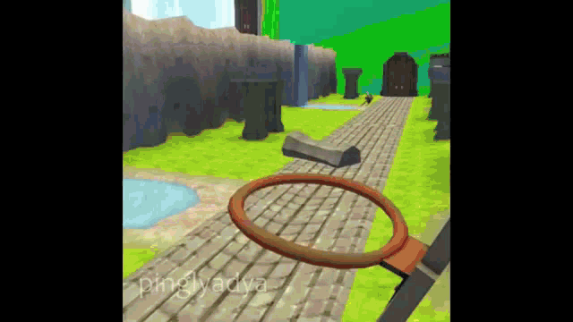

<div align="center">


</div>

```text
ROBCO INDUSTRIES (TM) TERMLINK PROTOCOL
========================================
> USER: NAJAIR / DOOMWAVE
> ACCESS LEVEL: WASTELAND DEVELOPER
> SYSTEM STATUS: RUNNING ON TEA
> DIRECTIVE: WRECK -N- RULE
========================================
```

<table>
<tr>
<td width="60%" valign="top">

### `> whoami`

Hey! I'm **Najair**, aka **DoomWave**. ☢️

- 🎓 Computer Science student exploring **cybersecurity**
- 🧠 Grinding **data structures & algorithms**
- 💻 Coding in **Python, Java, and JavaScript**
- 🔧 Break code. Fix code. Pretend it was intentional.
- ⚡ **+PARRY** incoming compiler errors
- 🍵 `tea.exe` is always running

**`[ SYSTEM STATUS: Running on Tea ]`**

</td>
<td width="40%" align="center" valign="middle">



<sub><i>me after fixing one bug and creating twelve more</i></sub>

</td>
</tr>
</table>

---

<div align="center">

### `> inventory --skills`


### `> pipboy --statistics`


### `> establish_connection`

<a href="https://github.com/DoomWave"></a>

---

**`> WRECK -N- RULE_`**

<sub>END OF TRANSMISSION // DOOMWAVE.exe</sub>


</div>
